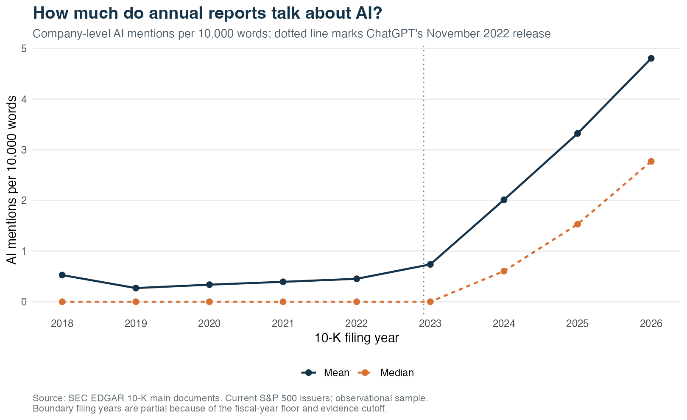
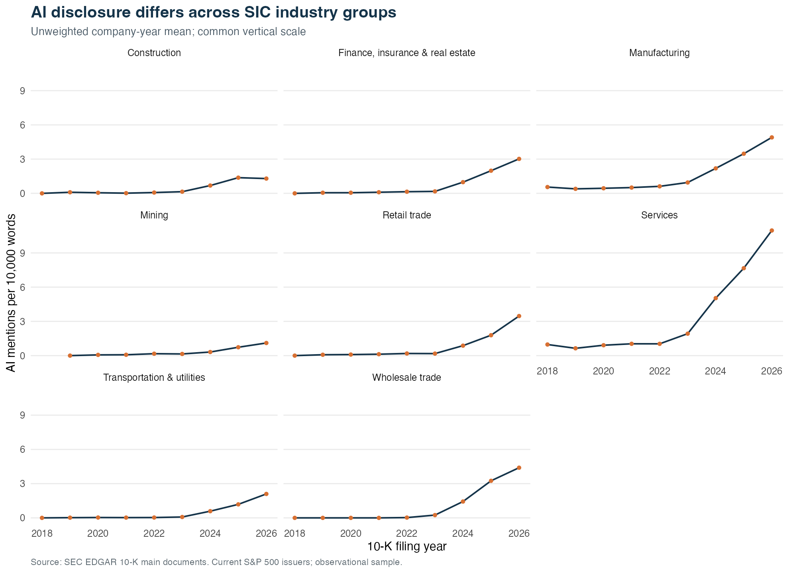
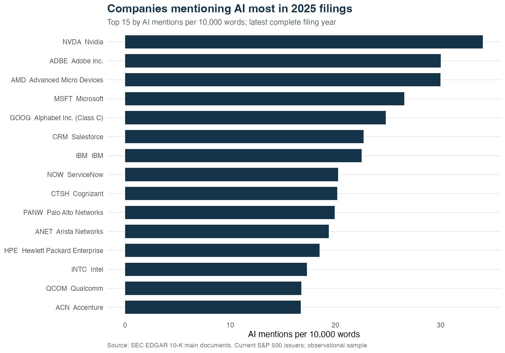
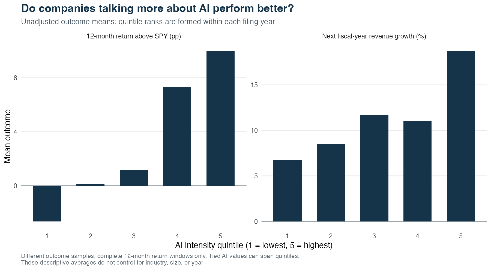
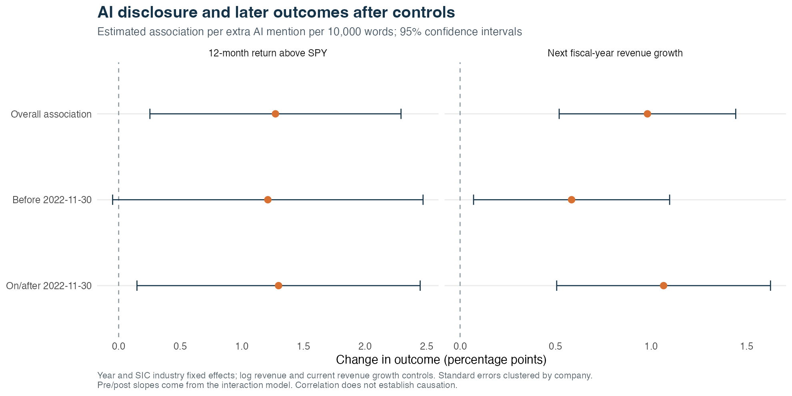

```{r}
# Read saved results so every narrative number is tied to this actual analysis run.
source("scripts/write_summary.R")
study <- read_study_outputs()
s <- study$summary
fmt <- format_number
pct <- function(x, digits = 1) paste0(fmt(100 * x, digits), "%")
pp_interval <- function(low, high) paste0("[", fmt(100 * low, 3), ", ", fmt(100 * high, 3), "]")
```

::: {.callout-note appearance="simple"}
The evidence cutoff is **`r study$as_of`**; saved run mode: **`r s$sample_mode`**. This report uses **`r format_count(s$n_filings)` filings from `r format_count(s$n_firms)` current S&P 500 issuers**, covering fiscal years **`r min(s$fiscal_years)`–`r max(s$fiscal_years)`**. The figures describe the observed sample; source failures and immature outcomes are recorded below.
:::

## What the data show

`r trend_sentence(study)`

`r coefficient_sentence(study, "next_revenue_growth")`

`r coefficient_sentence(study, "excess_return_12m")`

`r sensitivity_sentence(study, "excess_return_12m")`

These estimates describe associations. The study cannot establish that discussing AI causes growth or investment returns, or that ChatGPT caused a change in the relationship.

## Research question and measures

The question is whether a company that discusses AI more in a 10-K subsequently grows faster or earns a higher return than SPY, and whether this relationship differs after ChatGPT's **November 30, 2022** release.

The unit of observation is one issuer and fiscal-period-end annual report. AI intensity is the number of non-overlapping dictionary matches per **10,000 visible-text words**. Word tokens start with an alphabetic character and may contain letters, digits, apostrophes, and hyphens; standalone numbers are excluded from the denominator. The dictionary contains “artificial intelligence,” “machine learning,” “generative AI,” “large language model,” “LLM,” and standalone uppercase “AI.” Longer phrases take priority to avoid counting “generative AI” and its embedded “AI” twice. Only the standalone “AI” entry is case-sensitive; match boundaries prevent fragments inside longer words. The text scope is the requested primary 10-K document only. Incorporated annual reports and exhibits are not joined, so the amount and type of narrative included can vary by issuer.

The two outcomes are next fiscal-year revenue growth and the stock's 12-month adjusted-price return minus SPY's return over the same dates. Next-FY growth is the next original 10-K's annual revenue divided by the same-tag prior-year comparative in that next filing, minus one. This denominator may include a restatement of year t; it is not necessarily the original revenue value available when the year-t report was filed. Predictor revenue and current growth still come from the year-t original filing. Revenue growth is a percentage change; excess returns are differences in percentage points. The covariates are log annual revenue and the most recently observed fiscal-year revenue growth, both taken from the original filing. Calendar filing year and industry enter as fixed effects.

## Data coverage and recorded problems

The target population is a frozen snapshot of **current** S&P 500 constituents. `r study$membership_note` The [saved membership reconciliation](output/tables/membership_reconciliation.md) records the compared snapshots and their limits. This does not reconstruct historical index membership. Multiple share classes are collapsed to issuer CIK by selecting the alphabetically first ticker; the discarded listings are logged. The issuer list, filing accessions, selected revenue tags, price endpoints, and cache manifest allow the processed results to be traced to sources. ExxonMobil's July 2026 successor reorganization exchanged old shares one for one and retained the XOM ticker. Its historical annual reports and facts use the predecessor SEC CIK through the explicit mapping in `config/cik_history_overrides.csv`, while the panel retains the current issuer key and historical source CIK. HONA and VYLR are kept separate from their consolidated parent histories rather than automatically joined; the issuer-specific decisions and sources are recorded in [`config/issuer_history_notes.csv`](config/issuer_history_notes.csv). The mapping is supported by the [official successor filing](https://www.sec.gov/Archives/edgar/data/2115436/000119312526291990/d71068d8k12b.htm).

```{r}
#| results: asis
# Show aggregate coverage and return exclusions without hiding the underlying row-level ledgers.
for (name in intersect(c("coverage.csv", "return_exclusions.csv"), names(study$coverage))) {
  cat("\n\n**", name, "**\n\n", sep = "")
  print(knitr::kable(study$coverage[[name]], format = "html", digits = 0))
}
```

There are **`r format_count(s$n_revenue_outcomes)` available revenue outcomes** and **`r format_count(s$n_return_outcomes)` complete return outcomes** before requiring all regression controls. Missing revenue outcomes do not remove a filing from the text trend. An incomplete return window removes it from return analysis, while an available revenue outcome can still be used.

The return-status counts cover all discovered filings before final fiscal-year and usable-text filtering; the panel and model counts refer to observations after that filter. The complete exclusion ledgers are [panel exclusions](output/tables/panel_exclusions.csv), [return exclusion counts](output/tables/return_exclusions.csv), and [share-class exclusions](output/tables/share_class_exclusions.csv). Each excluded observation keeps its reason. A missing source response is never interpreted as zero AI mentions or zero growth.

The source-issue ledger contains **`r format_count(nrow(study$issues))` recorded issues**, including fallbacks that subsequently succeeded. A recorded event is not automatically a currently missing observation; the exclusion tables show the resulting analysis eligibility. The following table groups the issues for readability; [the complete ledger](output/tables/data_issues.csv) retains ticker, requested item, and specific error details.

```{r}
#| results: asis
# Surface source issues explicitly and retain the downloadable detailed ledger.
if (nrow(study$issues) > 0) {
  issues_by_reason <- study$issues %>% count(stage, reason, name = "Recorded issues") %>% arrange(stage, desc(`Recorded issues`))
  knitr::kable(issues_by_reason, col.names = c("Stage", "Reason", "Recorded issues"))
} else {
  cat("No source issues were recorded in the available issue ledger. This is not proof that all target observations exist.")
}
```

### Saved verification

`r verification_sentence(study)`

The [fiscal-year crosscheck](output/tables/fiscal_year_crosscheck.csv) preserves original DEI/API labels, verified cover values, and the selected label; the source-verified STX cover corrects an erroneous 2027 DEI label to fiscal 2025. The [targeted revenue-concept review](output/tables/revenue_concept_review.csv) records statement labels, selected concepts, and primary-document versus API-only checks. The [validation ledger](output/tables/validation_checks.csv) records each arithmetic, alignment, dictionary, window, and model check. The [source spot-check ledger](output/tables/source_spot_checks.csv) retains the selected filing URLs and distinguishes inline-document matches from companyfacts-only checks.

```{r}
# Keep selected source verification visibly separate from full-panel arithmetic checks.
if (nrow(study$source_checks)) {
  study$source_checks %>%
    transmute(Ticker = ticker, `Fiscal year` = fiscal_year,
              `Original companyfacts match` = original_companyfacts_match,
              `Inline revenue match` = if_else(is.na(inline_document_match), "Companyfacts only", as.character(inline_document_match)),
              `Independent AI count match` = ai_count_match) %>% knitr::kable()
}
```

## AI disclosure over time

{fig-alt="Line chart showing observed mean and median AI mentions per 10,000 words by calendar filing year."}

Means give each observed filing equal weight. **`r pct(s$share_zero_ai)`** of filings have no dictionary matches, so the median and the zero share help interpret a skewed mean. Filing-year composition can change because of IPOs, spin-offs, available histories, and source coverage. The first filing year is also partial because the fiscal-year eligibility floor does not retain all reports filed that year; the last filing year is partial at the evidence cutoff.

```{r}
# Compare the actual before and after groups, with denominators beside their means.
study$period_comparison %>%
  transmute(Period = period, Filings = n_filings, Firms = n_firms,
            `Mean intensity` = round(mean_ai_intensity, 2),
            `Median intensity` = round(median_ai_intensity, 2),
            `Any AI mention` = pct(share_any_ai)) %>% knitr::kable()
```

{fig-alt="Faceted line charts showing mean AI intensity by broad SIC industry and filing year on a shared vertical scale."}

These broad divisions use SIC codes from the submissions snapshot. They do not correspond to modern GICS technology sectors: SIC manufacturing includes several businesses that investors describe as technology companies.

```{r}
#| results: asis
# Show the constant-company comparison when enough complete filing years are available.
if (nrow(study$trend_balanced) > 0) {
  cat("The constant-company check retains ", format_count(s$n_balanced_trend_firms),
      " issuers observed in every included complete filing year (", min(study$trend_balanced$filing_year), "–", max(study$trend_balanced$filing_year), "). Both boundary years are excluded. It helps distinguish a changing sample from changes within an existing sample.\n\n", sep = "")
  study$trend_balanced %>%
    transmute(`Filing year` = filing_year, Firms = n_firms,
              `Mean AI intensity` = round(mean_ai_intensity, 2)) %>% knitr::kable()
} else {
  cat("A constant-company comparison is unavailable for this run.")
}
```

## Companies mentioning AI most

The ranking uses **`r s$ranking_filing_year`**, the latest complete calendar filing year in the observed data. It measures language intensity rather than AI spending, adoption quality, or financial value.

{fig-alt="Horizontal bars ranking companies by AI mentions per 10,000 words in the latest complete filing year."}

```{r}
# Keep the ranking tied to a specific filing, rather than pooling a changing number of years.
study$company_rankings %>% slice_head(n = 10) %>%
  transmute(Rank = rank, Ticker = ticker, Company = company,
            `Fiscal year` = fiscal_year, `Filing date` = filing_date,
            Mentions = ai_count, `Per 10,000 words` = round(ai_intensity, 2)) %>% knitr::kable()
```

## Five disclosure groups and later outcomes

{fig-alt="Two bar charts showing unadjusted mean next-fiscal-year revenue growth and 12-month returns above SPY across AI quintiles."}

Quintiles are formed separately within each filing year using ranks, with tied values ordered by CIK. Identical values, including zeros, can therefore span more than one group. These are rank groups rather than five distinct intensity thresholds. The table provides actual ranges, zeros, and outcome-specific counts.

```{r}
# Put the available outcome sample beside each descriptive mean.
study$quintile_summary %>%
  transmute(Quintile = ai_quintile, Filings = n_filings, `Zero AI` = n_zero_ai,
            `Intensity range` = paste0(fmt(ai_min), "–", fmt(ai_max)),
            `Revenue N` = n_revenue_outcomes, `Mean growth` = pct(mean_next_revenue_growth),
            `Return N` = n_return_outcomes, `Mean above SPY` = paste0(fmt(100 * mean_excess_return_12m), " pp")) %>%
  knitr::kable()
```

The next table treats all zero-mention filings as one group and divides positive-intensity filings into within-year quartiles. It checks whether the visual pattern depends on splitting ties. Group means remain unadjusted for size, year, and industry; differing means are not evidence of causality.

```{r}
# Provide a tie-aware comparison alongside the required quintiles.
study$exposure_groups_summary %>%
  transmute(Group = exposure_group, Filings = n_filings,
            `Revenue N` = n_revenue_outcomes, `Mean growth` = pct(mean_next_revenue_growth),
            `Return N` = n_return_outcomes, `Mean above SPY` = paste0(fmt(100 * mean_excess_return_12m), " pp")) %>%
  knitr::kable()
```

## Regression results

For each outcome, the primary specification regresses the outcome on AI intensity, log revenue, and the observed current fiscal-year growth rate, with calendar filing-year and broad SIC-industry fixed effects. Standard errors are clustered by issuer CIK. Each outcome uses its own complete-case sample. The primary models do not trim or winsorize outcomes.

{fig-alt="Coefficient plots with 95 percent confidence intervals for overall, pre-release, and post-release AI intensity slopes for both outcomes."}

```{r}
# Report the main AI estimates in interpretable percentage-point units.
study$regression_coefficients %>% filter(model == "baseline", term == "ai_intensity") %>%
  transmute(Outcome = outcome_label(outcome), `AI slope (pp)` = fmt(100 * estimate, 3),
            `95% CI (pp)` = pp_interval(conf_low, conf_high), `p-value` = sub("^=", "", format_p(p_value)),
            Observations = n_obs, Firms = n_firms) %>% knitr::kable()
```

One unit of intensity is **one additional dictionary mention per 10,000 words**. Multiply saved decimal-rate coefficients by 100 to obtain percentage-point effects. An interval that includes zero means the sample and specification do not distinguish the association from zero at the 5% level; it does not establish the absence of an association.

### Did the relationship change after ChatGPT?

The interaction model adds `AI intensity × post2022` and the post indicator, defined by the **actual filing date on or after 2022-11-30**. The AI main coefficient is the pre-period slope. The interaction is the change in slope. The post-period slope is their sum, with its confidence interval calculated from the full coefficient covariance matrix. Any collinear terms removed by the estimator are listed in model status.

`r interaction_sentence(study, "next_revenue_growth")`

`r interaction_sentence(study, "excess_return_12m")`

```{r}
# Show all three relevant estimates rather than confusing an interaction with a post-period effect.
study$effect_slopes %>% filter(model == "interaction") %>%
  transmute(Outcome = outcome_label(outcome),
            Period = recode(period, pre = "Before release", post = "On/after release", change = "Slope change"),
            `Slope / change (pp)` = fmt(100 * estimate, 3),
            `95% CI (pp)` = pp_interval(conf_low, conf_high), `p-value` = sub("^=", "", format_p(p_value)),
            Observations = n_obs, Firms = n_firms) %>% knitr::kable()
```

### Sensitivity and model availability

`r sensitivity_sentence(study, "next_revenue_growth")`

`r sensitivity_sentence(study, "excess_return_12m")`

The sensitivity specifications use log-transformed AI intensity, firm and year fixed effects, and outcome values winsorized at the 1st and 99th percentiles. Firm effects compare changes within issuers, while the requested industry/year model also uses differences across companies. Winsorization changes the outcome being modeled and is not the main result. The log-intensity coefficient has a different regressor unit and should not be compared directly with the raw-intensity coefficient's magnitude.

```{r}
# Retain sensitivity estimates and model failures instead of presenting only favorable specifications.
study$regression_coefficients %>%
  filter(!model %in% c("baseline", "interaction"), term %in% c("ai_intensity", "log_ai")) %>%
  transmute(Outcome = outcome_label(outcome), Model = model,
            Regressor = term, `Coefficient (pp / unit)` = fmt(100 * estimate, 3),
            `95% CI (pp)` = pp_interval(conf_low, conf_high), `p-value` = sub("^=", "", format_p(p_value)),
            Observations = n_obs, Firms = n_firms) %>% knitr::kable()
```

```{r}
# Make estimation failures, collinearity, and regression sample sizes inspectable.
study$model_status %>%
  transmute(Outcome = outcome_label(outcome), Model = model, Status = status,
            `Available rows` = n_available, `Used rows` = n_obs, Firms = n_firms,
            `Error or removed terms` = replace_na(as.character(message), "")) %>% knitr::kable()
```

[All regression coefficients](output/tables/regression_coefficients.csv), [all pre/post slopes](output/tables/effect_slopes.csv), and [model status](output/tables/model_status.csv) are provided as CSV files. Several related outcomes and specifications are tested, so their p-values should be read as exploratory rather than as separately preregistered discoveries.

## How the data are constructed

1. **Freeze current constituents and CIKs.** The sample follows current S&P 500 membership, then collapses multiple traded share classes to one issuer. The 20-company run checks the full chain before the complete sample is collected.
2. **Retrieve original annual reports.** SEC submissions JSON and its historical pages identify 10-K primary documents. The raw response is cached; amendments do not become duplicate annual observations. Fiscal year is read from the filing's DEI focus where available, with an original-accession XBRL fallback. Explicitly verified cover-page labels take priority to fill missing labels or correct a documented erroneous DEI tag, while preserving the original DEI value. The cover-label ledger contains **`r nrow(study$fiscal_overrides)` verified filings**. Cover statements and source URLs are recorded in `config/fiscal_year_overrides.csv`; text is retained even when a supported revenue fact is unavailable. Calendar filing year remains a separate variable.
3. **Clean visible text and count dictionary terms.** Hidden XBRL, script, and style content are removed. Non-overlapping phrase matches and a documented word denominator produce intensity. The editable dictionary is [`config/ai_dictionary.csv`](config/ai_dictionary.csv).
4. **Select original annual revenue facts.** Annual-duration USD values are matched to the original accession and actual period dates. The resulting issuer-specific revenue proxy is not standardized operating sales: it can include other or investment income, while bank totals can be net of interest expense. Alternative revenue tags use precedence, never addition. Predictor growth compares same-tag current/prior annual facts from that filing. Next-FY growth uses the next original annual filing's same-tag current/prior comparison. Its prior-year denominator may have been restated in that filing, while the predictors still use the year-t original filing. The prior period end must match the current report's fiscal period end, and the next period must be annual and adjacent; absent or nonconsecutive periods stay missing.
5. **Match future price windows.** The first common adjusted closing price strictly after the filing date is the start. The endpoint is the first common closing price on or after the 12-month calendar anniversary, with a seven-day tolerance for each endpoint. Stock and SPY dates must match. The anniversary must already be observable, and both endpoints must exist. This closing-price convention excludes the first post-filing session's intraday return.
6. **Build separate complete-case model samples.** Text trends use observed reports. Each outcome model additionally requires its outcome and controls. Every missing or excluded component retains its status.

Successful SEC responses are cached under `data/raw` and reused. The User-Agent is `Haoqi Luo haoqi.luo23@hoosac.org`; SEC requests share a four-requests-per-second throttle, with up to five concurrent primary-document transfers; retries use the same throttle. The download manifest records URLs, timestamps, file sizes, and hashes. A new snapshot may differ when membership, source availability, prices, or restated facts change.

## Limits on the conclusions

- **Survivorship and selection.** Current index members survived and qualified for inclusion. Their earlier results do not represent all companies that existed in each historical year. Firms lacking suitable 10-K or standard XBRL data can create further selection.
- **Reverse causality and omitted differences.** Growth opportunities, management incentives, business model, firm size, R&D, and existing AI capability can influence both language and outcomes. Size, prior growth, industry, and year controls do not remove all those differences. Larger companies are not assumed to grow faster; size is controlled rather than treated as an explanation proven by this study.
- **Language is not investment.** Mentions include risks, compliance, customer demand, and boilerplate. The dictionary misses unlisted phrases and cannot establish whether AI was adopted successfully. Restricting text to the main 10-K excludes incorporated documents and exhibits; USB, WFC, and PGR in the targeted review incorporate annual-report financials by reference, demonstrating that text scope differs across issuers.
- **Financial comparability.** SEC companyfacts covers standard-taxonomy entity-level facts, not every custom or segment measure. Revenue definitions, financial firms, acquisitions, spin-offs, and fiscal-calendar changes can make growth hard to compare. Some selected totals include other or investment income, and bank totals can be net of interest expense. For example, the targeted CVX review distinguishes the selected “Total Revenues and Other Income” concept from narrower operating sales. Industry fixed effects do not standardize these accounting definitions. Original-filing values reduce look-ahead in predictors but can differ from later restated history.
- **Timing.** A 10-K appears after its fiscal year closes, so part of the next fiscal year has already elapsed at filing. Recent filings have fewer mature outcomes. A November 2022 split coincides with many economic and technology changes, and is not a natural experiment by itself.
- **Returns and inference.** SPY subtraction does not adjust for sector, size, valuation, or factor exposure. Overlapping market periods and common shocks can leave cross-company dependence despite company clustering. Skew, outliers, repeated tests, and current-member selection limit the interpretation of p-values and economic significance.

## Reproduce and explore

```{.bash}
Rscript -e 'source("install.R")'
Rscript run.R --sample20
Rscript run.R --full
quarto render report.qmd
Rscript -e 'shiny::runApp("app")'
```

For analysis-only reproduction from the included processed snapshot, with no SEC or Yahoo downloads:

```{.bash}
Rscript scripts/replay_analysis.R --full
quarto render report.qmd
```

This entry point reruns the analysis, panel validation, and summary generation. The included CI workflow is configured to use this offline-data path; it does not certify a fresh source download.

The simpler `install.R` path installs the required packages. To opt into the versions recorded in `renv.lock`, install `renv` if needed, run `renv::activate()` in R (restart if prompted), then `renv::restore()`. The project does not autoactivate renv by default. See the official [activation](https://rstudio.github.io/renv/reference/activate.html) and [restore](https://rstudio.github.io/renv/reference/restore.html) documentation.

Run commands from the project root. The default evidence cutoff is `2026-10-26`; set `ANALYSIS_AS_OF` deliberately to collect a new dated snapshot. Keep the raw cache for exact replay. Changing the cutoff does not refresh the frozen constituent list; archive and deliberately refresh that cache separately for a new universe snapshot. Use `Rscript scripts/write_summary.R` to regenerate the README and bilingual portfolio copy from the saved run. The local Shiny application reads the same panel and permits company and industry exploration.

## Sources

- [SEC EDGAR API documentation](https://www.sec.gov/search-filings/edgar-application-programming-interfaces): submissions history, historical files, and standard XBRL facts.
- [SEC access and fair-use policy](https://www.sec.gov/search-filings/edgar-search-assistance/accessing-edgar-data): declared User-Agent and request-rate policy.
- [SEC SIC code list](https://www.sec.gov/search-filings/standard-industrial-classification-sic-code-list): business classifications.
- [Archived current constituent source](https://en.wikipedia.org/wiki/List_of_S%26P_500_companies): current S&P 500 listings and issuer CIKs; the declared company snapshot reconciled to saved fresh SSGA/tidyquant holdings after excluding fund cash and a nonconstituent contra position.
- [tidyquant index data](https://business-science.github.io/tidyquant/reference/tq_index.html) and [stock prices](https://business-science.github.io/tidyquant/reference/tq_get.html): constituent and Yahoo Finance price interfaces.
- [fixest estimation documentation](https://lrberge.github.io/fixest/reference/feols.html): fixed-effects models and clustered inference.
- [OpenAI's release announcement](https://openai.com/index/chatgpt/): ChatGPT's November 30, 2022 release date.
